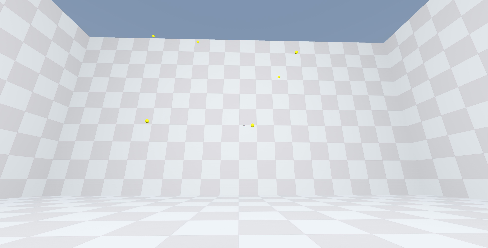

# OpenAimTrainer
🎯 **Open Aim Trainer** is a free and open source aim trainer that allows you to improve your aim in both 2D and 3D games. It is made with the **Godot game engine**, which is a free and open source game engine that is easy to learn and use.

It features a variety of different training modes, including:

🧍 **Static targets**: These targets stay in one place, so you can focus on improving your accuracy.

🏃 **Moving targets**: These targets move around, so you need to track them with your crosshair.

⚙️ Open Aim Trainer also features a variety of customization options, so you can tailor the training to your specific needs. You can choose the type of targets, the speed of the targets, and the scoring system.

🏆 Whether you're a beginner or a pro, Aim Trainer is a great way to improve your aim in any game. It's free, open source, and easy to use. So what are you waiting for? Start training today!



### Features:

🏎️ Made with the Godot game engine

👟 Variety of training modes (4 × 3D + 3 × 2D, 60 s per round)

⚙️ Customizable settings (crosshair, target color, sensitivity conversion, render scale, display mode)

🌐 15 UI languages (incl. Simplified / Traditional Chinese, Japanese, Korean, Russian, Arabic …)

🆓 Free and open source

### Benefits:

🎯 Improve your aim in any game

🤯 Tailor the training to your specific needs

💪 Easy to use

### Get started:

⏬ Download the latest version of Open Aim Trainer

🖥️ Install the game on your computer

🏁 Start training!

### For more information:

🌐 Visit the Open Aim Trainer website [Website](https://openaimtrainer.com/)

💬 Join the Open Aim Trainer Discord server [Discord](https://discord.com/invite/bbKAEF6QQs)

📖 Full help manual (Chinese): [docs/OpenAimTrainer_使用说明.md](docs/OpenAimTrainer_使用说明.md)


### Basic structure
```
/project-root
├── project.godot
├── README.md
├── assets
│   ├── fonts
│   ├── images
│   ├── text          # 翻译源表 CSV 与 15 个编译产物 .translation
│   └── themes
├── scenes
│   ├── characters
│   ├── levels
│   └── ui
├── scripts
│   ├── characters
│   ├── data_manager.gd     # 自动加载：存档读写
│   ├── global.gd           # 自动加载：模式配置 / 显示模式 / 成绩记录
│   ├── levels
│   └── ui
├── tools                   # 命令行工具（CSV → .translation 编译）
├── web                     # Web 导出壳
└── docs                    # 使用说明 + 项目分析 / 架构 / 优化报告
```

---

# OpenAimTrainer（中文版）

> 以下是上方英文 README 的中文翻译版本，**并附带完整的帮助文档**。

🎯 **Open Aim Trainer** 是一款免费开源的瞄准训练器，提供 2D 与 3D 两种训练方式，帮助你提升瞄准水平。项目基于 **Godot 引擎** 开发 —— 一款免费开源、易学易用的游戏引擎。

内置多种训练模式，包括：

🧍 **静止靶**：靶子固定不动，专注练习精准度。

🏃 **移动靶**：靶子会移动，需要用准星持续跟踪。

⚙️ Open Aim Trainer 还提供丰富的自定义选项：准星（形状 / 粗细 / 间隙 / 颜色 / 描边）、靶子颜色、灵敏度换算、渲染缩放、显示模式与界面语言均可设置。

🏆 无论你是新手还是高手，Aim Trainer 都是提升任何游戏中瞄准水平的好帮手。它免费、开源、上手简单。


## 📖 帮助文档（设置方法 / 效果 / 玩法）

> 更详细的版本见 [docs/OpenAimTrainer_使用说明.md](docs/OpenAimTrainer_使用说明.md)。

### 一、怎么跑起来

| 方式 | 操作 |
| --- | --- |
| 桌面端（推荐） | 双击项目根目录的 `启动游戏.bat` |
| 编辑器调试 | 双击 `打开编辑器.bat`，按 F5 运行 |
| Web 版 | Godot 导出 Web 后打开 `web/index.html`（无渲染缩放、无窗口模式、无退出按钮，灵敏度额外 ×0.6786） |

### 二、首页设置（每项是什么、有什么效果）

| 设置项 | 默认值 | 作用与效果 |
| --- | --- | --- |
| **3D 开关** | 开 | 勾选 → 右侧 4 个 3D 模式并显示灵敏度 / 渲染缩放；取消 → 3 个 2D 模式，并隐藏灵敏度与设置按钮（2D 用屏幕点击，不换算灵敏度） |
| **Game（游戏）** | 无畏契约 | 选择灵敏度换算基准：无畏契约 / 反恐精英 (CS) / 堡垒之夜。显示名跟随界面语言，内部 key 不变，不影响存档 |
| **Sensitivity（灵敏度）** | 0.215 | 填**你在该游戏里真实使用的数值**；实际转速 = 该值 × 换算系数（度/像素）。改完需**重开一局**生效。输入会自动校验：留空 / 非数字保留上一次有效值，中文全角标点（`0，5`）按 `0.5` 处理，范围夹在 0.001 ~ 1000 |
| **渲染缩放滑条** | 100% | 范围 0.5–2.0、步长 0.25（7 档）。改的是 3D 渲染分辨率倍率：调高更清晰更吃显卡，调低提升帧率。仅在 3D + 桌面端显示 |
| **开始训练** | — | 在当前维度（3D / 2D）里随机抽一个模式开始 |
| **设置 / 退出** | — | 进入 Options / 退出程序（Web 版无退出） |

灵敏度换算表（`scripts/global.gd`）：

| 游戏 | 换算系数 | 常见取值 | 等价关系 |
| --- | --- | --- | --- |
| 无畏契约 Valorant | 0.0707589… | 0.15 – 0.8 | 基准 |
| 反恐精英 (CS) | 0.0222372… | 0.5 – 2.5 | ≈ Valorant × 3.18 |
| 堡垒之夜 Fortnite | 0.0056153… | 3 – 10 | ≈ Valorant × 12.6 |

> 没有「越高越好」：高值转向快但易飘，低值更稳但跟不上快速移动靶。调到「能稳定 180° 转身且不过冲」为准。

### 三、设置页（Options）逐项说明

**准星（CROSSHAIR）**

| 项 | 默认 | 效果 |
| --- | --- | --- |
| Crosshair（总开关） | 开 | 关掉则只剩中心点（Dot 也关则无准星） |
| Outline（描边） | 开 | 给准星加描边，亮背景下更清楚 |
| Crosshair inner（内臂） | 开 | 中间四条短臂；关掉只剩中心点 |
| Dot（中心点） | 关 | 中心方形小点，静态点击常用 |
| DotSize（点径） | 6 | 中心点半边长，2–4 精细 / 6–10 醒目 |
| OutlineSize（描边粗细） | 2 | 1 细腻，3–4 在杂乱背景更清楚 |
| CrosshairHeight（臂粗） | 4 | 半厚度，臂总厚 = 2 × 该值 |
| CrosshairWidth（臂长） | 12 | 从中心间隙外缘向外延伸的长度 |
| CrosshairSpace（中心间隙） | 5 | 中心留空半径，0 时中心闭合 |
| CrosshairColor | `#00FFFF` 青 | 准星主体颜色 |
| OutlineColor | `#000000` 黑 | 描边颜色（浅背景用黑、深背景可用白） |

**目标（TARGET）**

| 项 | 默认 | 效果 |
| --- | --- | --- |
| TargetColor | `#FFFF00` 黄 | 同时作用于 3D 靶（材质）与 2D 靶（着色），下一局生效 |

**界面与显示**

| 项 | 默认 | 效果 |
| --- | --- | --- |
| Language（语言） | 跟随系统，缺省英文 | 15 种：English / Español / 简体中文 / 繁體中文（台灣）/ 繁體中文（香港）/ 日本語 / 한국어 / Français / Deutsch / Português (Brasil) / Русский / Italiano / Türkçe / العربية / Tiếng Việt；切换后立即重载界面（含模式名与游戏名），并支持 `zh_TW`、`zh_HK`、`pt`、`de_DE`、`es_419` 等变体匹配 |
| Display（显示模式） | 全屏 | 窗口 / 最大化 / 全屏；训练不再强制全屏，只需鼠标捕获态 |
| Window size（窗口大小） | 1600 × 900 | 1280×720 / 1600×900 / 1920×1080 / 2560×1440；选尺寸会自动切到窗口模式，超出屏幕时自动收敛并居中 |

**导入 / 导出**

| 按钮 | 效果 |
| --- | --- |
| Export | 导出全部设置为 `open_aim_trainer.json`（Web 端为浏览器下载；桌面端对话框默认打开系统「文档」目录） |
| Import | 导入 JSON 覆盖当前设置并立即落盘（桌面端同样默认打开「文档」目录） |
| Back | 返回首页 |

### 四、玩法详解（7 种模式，统一 60 秒一局）

**3D（第一人称：鼠标转视角、`WASD` 移动、`空格` 跳跃、左键射击；靶子 10 血 / 子弹 10 伤 → 一枪即碎并立即补靶；移动中开枪最大 ±2° 扩散）**

| 模式 | 靶数 | 尺寸 | 生成范围 X / Y | 移动 | 练什么 |
| --- | --- | --- | --- | --- | --- |
| 3D 头部高度靶 | 1 | 0.5 | ±24 / 固定 4 | 否 | 头部线预瞄、横向拉枪与开枪节奏 |
| 3D 多目标 · 移动（小） | 6 | 0.5 | ±12 / 4–20 | 是 | 目标切换 + 动态跟枪 |
| 3D 多目标 · 静止（小） | 6 | 0.5 | ±12 / 4–20 | 否 | 小靶静态点击、微定位与手速 |
| 3D 多目标 · 中型（大） | 3 | 3 | ±11 / 4–15 | 否 | 近距离大靶快速击杀、连贯性 |

**2D（鼠标点击圆靶，点中即得分并补靶；不使用游戏灵敏度；尺寸以 1920 宽为基准等比放大）**

| 模式 | 靶数 | 尺寸 | 移动 | 练什么 |
| --- | --- | --- | --- | --- |
| 2D 网格速点 | 3 | 60 px | 否 | 经典 Gridshot：大范围快速定位与点击节奏 |
| 2D 反应点击 | 1 | 40 px | 否 | 出现即点，练反应与首次定位 |
| 2D 移动追踪 | 5 | 40 px | 是 | 平滑跟手与提前量预判 |

**结算**：3D 显示 `击杀数 ｜ 命中率 ｜ 历史最佳`；2D 显示 `得分 ｜ 历史最佳`。成绩按模式分别记录，只在破纪录时更新；结算面板可 重新开始 / 主菜单。

### 五、快捷键与存档

| 按键 | 作用 |
| --- | --- |
| 鼠标左键 | 射击（3D）/ 点击靶子（2D） |
| `W` `A` `S` `D` / `空格` | 移动 / 跳跃（仅 3D） |
| `Esc` | 暂停 / 结算面板 |
| `F` | 首页：窗口 ⇄ 全屏（输入框有焦点时不触发） |

存档：`user://open_aim_trainer.json`（Windows 下为 `%APPDATA%\Godot\app_userdata\Open Aim Trainer\open_aim_trainer.json`），包含语言、显示、灵敏度、准星、颜色与成绩记录；可用 Export / Import 整体迁移。Import 只接受能解析成 JSON 对象的文件，解析失败会保留原设置（不会清空）；存档损坏时启动会先备份为 `.bak`。

### 功能特性：

🏎️ 使用 Godot 引擎开发

👟 多样化的训练模式（3D × 4 + 2D × 3）

⚙️ 可自定义的设置项（准星几何 / 颜色 / 灵敏度换算 / 渲染缩放 / 显示模式）

🌐 15 种界面语言，运行期即时切换

🆓 免费且开源

### 使用收益：

🎯 提升你在任意游戏中的瞄准水平

🤯 按需定制训练内容

💪 简单易用

### 快速开始：

⏬ 下载最新版 Open Aim Trainer

🖥️ 在本机安装游戏

🏁 开始训练！

### 了解更多：

🌐 访问 Open Aim Trainer 官网 [Website](https://openaimtrainer.com/)

💬 加入 Open Aim Trainer 的 Discord 服务器 [Discord](https://discord.com/invite/bbKAEF6QQs)

### 目录结构
```
/project-root
├── project.godot           # 引擎配置（autoload / 输入映射 / 国际化 / 显示）
├── README.md
├── assets
│   ├── fonts               # 描边字体（HUD 用）
│   ├── images              # Logo、靶面纹理、模式封面
│   ├── text                # translations.csv 源表（15 个 locale 列）+ 15 个 .translation
│   └── themes              # UI 主题资源
├── scenes
│   ├── characters          # target.tscn(3D) / Target2D.tscn
│   ├── levels              # World.tscn(3D) / World2D.tscn / Bullet.tscn
│   └── ui                  # MainScreen / Options / 模式预览
├── scripts
│   ├── characters
│   ├── data_manager.gd     # 自动加载：user:// 存档读写
│   ├── global.gd           # 自动加载：模式配置 / 显示模式 / 成绩记录
│   ├── levels
│   └── ui
├── tools                   # CSV → .translation 编译脚本
├── web                     # Web 导出壳（index.html / 图标 / 素材）
└── docs                    # 使用说明 + 项目分析、缺陷排查与模块架构报告
```

### 本地开发

修改 `assets/text/translations.csv` 后，需重新编译翻译资源才会生效（推荐用引擎自带导入器，它会按 CSV 列自动生成全部 15 个 `.translation`）：

```powershell
# 推荐：引擎导入器（自动按 CSV 表头生成所有 locale）
godot --headless --path . --import

# 备选：自写脚本（同样从 CSV 表头读取 locale）
godot --headless --path . --script res://tools/build_translations.gd
```

无头启动冒烟检查（无 `SCRIPT ERROR` / `Parse Error` 即通过）：

```powershell
godot --headless --path . --quit-after 200
```

> 注意：`.translation` 是按 Godot 导入流程生成的二进制资源，不要手改；新增语言时同步更新 `project.godot → locale/translations` 与 `translations.csv.import` 的 `dest_files`。
